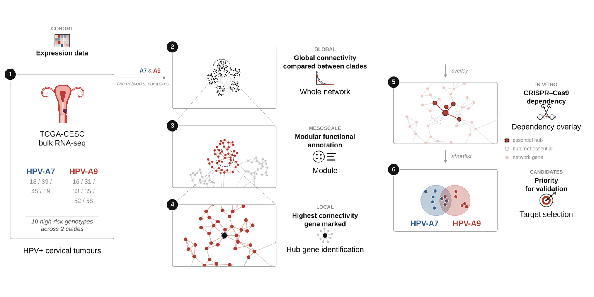

# Divergent co-expression network architecture and gene essentiality across HPV clades in cervical cancer

Analysis code for the manuscript by Joel Ruiz-Hernández, Guillermo de Anda-Jáuregui,
Hugo Tovar and Enrique Hernández-Lemus.

Primary cervical tumours of the TCGA-CESC cohort are stratified by the phylogenetic
clade of their infecting HPV genotype, a genome-wide co-expression network is
reconstructed for each clade, and the two networks are compared at the global,
modular and gene level. CRISPR-Cas9 loss-of-function data from clade-matched
cervical cancer cell lines are then overlaid to identify genes that are both highly
connected and strongly required.



## Pipeline

Directories and scripts are numbered in the order they are run. Each step reads the
outputs of the previous ones and writes its own into its `results/` folder; the
figures and the supplementary table of the paper are written to `figures/` and
`tables/`.

### 01_hpv_clades
`01_hpv_clade_assignment.R` — assigns the HPV genotype and the phylogenetic clade
(A7, A9) to every TCGA-CESC sample.

### 02_cohort_data
`01_download_expression.R` — retrieves the TCGA-CESC expression matrix.
`02_build_metadata.R` — assembles the clinical metadata and the clade labels.

### 03_preprocessing
`01_normalise_rnaseq.R` — low-count filtering, GC-content and transcript-length bias
correction, TMM normalisation.
`02_figure_S1_qc_panel.R` — **Supplementary Figure S1**.

### 04_network_inference
`01_run_aracne.sh` — ARACNe-AP over the complete set of expressed genes, 100
bootstrap replicates per clade.
`02_consolidate_networks.sh` — consolidates the bootstraps into the consensus network.

### 05_topology
`01_match_edge_counts.R` — reduces both networks to a common edge count.
`02_table_S1_global_topology.R` — **Supplementary Table S1**.
`03_figure_S2_degree_fit.R` — **Supplementary Figure S2**.
`04_figure_2_topology_panel.R` — **Figure 2**.

### 06_modules
`01_louvain_modules.R` — Louvain community detection per network.
`02_hallmark_enrichment.R` — Hallmark over-representation per module, with the
leading-edge genes.
`03_figure_3_modules_hallmark.R` — **Figure 3**.

### 07_dependency
`01_depmap_download.R` — Chronos gene effect for the clade-matched cervical lines
and the DepMap common-essential set.
`02_integrate_degree_dependency.R` — joins degree and clade gene effect per gene.
`03_hub_dependency_tests.R` — hub versus non-hub dependency and its permutation null.
`04_figure_S4_hub_essentiality.R` — **Supplementary Figure S4**.
`05_figure_S3_elbow_thresholds.R` — **Supplementary Figure S3**.
`06_essential_hub_modules.R` — essential-hub gene lists and the modules they occupy.
`07_hub_dependency_table.R` — per-gene hub dependency table.
`08_figure_4_essential_hubs.R` — **Figure 4**.
`09_table_S2_essential_hubs.R` — **Supplementary Table S2**.
`10_figure_5_leading_edge_circos.R` — **Figure 5**.

Connectivity and essentiality cutoffs are not set by hand. Genes are ranked by each
measure and the cutoff is placed at the elbow of the ranked curve, defined as the
point of maximum distance to the chord joining its two ends after rescaling both
axes to the unit interval. The same rule is applied to both measures and both
networks (`07_dependency/05_figure_S3_elbow_thresholds.R`).

## Figures and tables

Every item below is produced by the script named next to it and written to
`figures/` or `tables/`. `Figure_1_graphical_abstract.png` is drawn, not computed.

| Item | Script |
| --- | --- |
| `Figure_2_topology` | `05_topology/04_figure_2_topology_panel.R` |
| `Figure_3_modules_hallmark` | `06_modules/03_figure_3_modules_hallmark.R` |
| `Figure_4_essential_hubs` | `07_dependency/08_figure_4_essential_hubs.R` |
| `Figure_5_leading_edge_circos` | `07_dependency/10_figure_5_leading_edge_circos.R` |
| `Figure_S1_qc_normalisation` | `03_preprocessing/02_figure_S1_qc_panel.R` |
| `Figure_S2_degree_distribution_fit` | `05_topology/03_figure_S2_degree_fit.R` |
| `Figure_S3_elbow_thresholds` | `07_dependency/05_figure_S3_elbow_thresholds.R` |
| `Figure_S4_hub_essentiality` | `07_dependency/04_figure_S4_hub_essentiality.R` |
| `Table_S1`, printed to the console | `05_topology/02_table_S1_global_topology.R` |
| `Table_S2_essential_hubs.csv` | `07_dependency/09_table_S2_essential_hubs.R` |

Each figure is saved as PNG and as vector PDF. Only the PNG is versioned here.

## Data

None of the input data is versioned. It is obtained by the scripts themselves or
from the public sources below.

- **Expression and clinical data**: TCGA-CESC, retrieved through the OCTAD platform
  (`octad`, `octad.db`).
- **HPV genotypes**: the HPV-EM assignments published for TCGA-CESC; the clade
  assignment is rebuilt from them in step 01.
- **Gene dependency**: DepMap CRISPR Chronos gene effect, restricted to cervical
  cancer cell lines with an independently verified HPV genotype, retrieved with the
  `depmap` package.
- **Gene sets**: MSigDB Hallmark collection, through `msigdbr`.

The ARACNe bootstrap replicates are not kept in the repository either; step 04
regenerates them, and `04_network_inference/A7` and `A9` hold the consensus network
each clade ends with.

## Requirements

R 4.5.1. Network inference runs outside R with
[ARACNe-AP](https://github.com/califano-lab/ARACNe-AP).

CRAN: `tidyverse`, `dplyr`, `ggplot2`, `tibble`, `readr`, `stringr`, `scales`,
`vroom`, `patchwork`, `ggrepel`, `ggforce`, `ggh4x`, `ggnewscale`, `ggvenn`,
`gg.gap`, `viridis`, `circlize`, `igraph`, `poweRlaw`, `plotrix`, `png`, `grid`.

Bioconductor: `NOISeq`, `EDASeq`, `edgeR`, `biomaRt`, `Biobase`, `Biostrings`,
`GenomicRanges`, `BSgenome.Hsapiens.UCSC.hg38`, `ExperimentHub`, `depmap`,
`clusterProfiler`, `msigdbr`, `UCSCXenaTools`.

GitHub: `octad`, `octad.db`.

Versions stated in the manuscript: NOISeq 2.46.0, EDASeq 2.36.0, biomaRt 2.58.2,
poweRlaw 1.0.0, msigdbr 26.1.0.

## Running the code

Scripts resolve their paths against `~/CESC_Network`. Clone the repository into your
home directory, or edit the directory assignment at the top of the script you want
to run.

```
git clone https://github.com/JoelRuiz26/CESC_Network.git ~/CESC_Network
cd ~/CESC_Network
Rscript 07_dependency/08_figure_4_essential_hubs.R
```

Each figure script is self-contained given the intermediate tables of its step, so a
figure can be regenerated without rerunning the whole pipeline.

## Layout

```
01_hpv_clades/          HPV genotype and clade assignment
02_cohort_data/         cohort retrieval and metadata
03_preprocessing/       filtering, bias correction, normalisation
04_network_inference/   ARACNe-AP and the consensus network of each clade
05_topology/            edge matching and global topology
06_modules/             Louvain modules and Hallmark over-representation
07_dependency/          dependency integration and essential hubs
figures/                the figures of the paper
tables/                 the supplementary table
```

## Citation

Ruiz-Hernández J, de Anda-Jáuregui G, Tovar H, Hernández-Lemus E. *Divergent
co-expression network architecture and gene essentiality across HPV clades in
cervical cancer.*
